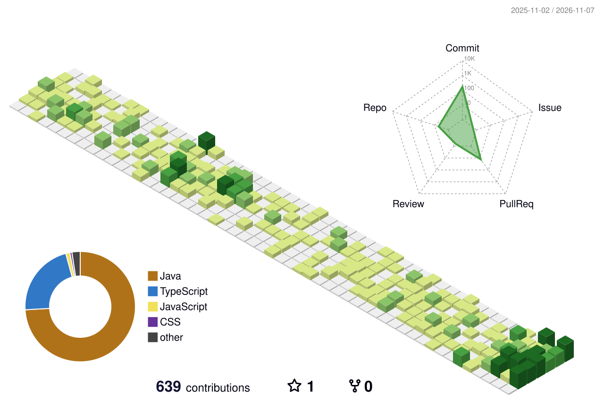

# Hi, I'm Gopi 👋

I'm a self-taught developer who likes building things end to end, from the API and database to the UI. I enjoy the hard parts most: making a system stay correct when lots of users hit it at once, or fast when it has to do a lot of work.

🌐 [gopisv.vercel.app](https://gopisv.vercel.app) · 💼 [LinkedIn](https://www.linkedin.com/in/gopisv/) · 📫 [gopisvdev@gmail.com](mailto:gopisvdev@gmail.com)

# 💻 Tech Stack

  

   

  

  

 

<picture>
  <source media="(prefers-color-scheme: dark)" srcset="./profile-3d-contrib/profile-night-green.svg" />
  
</picture>
